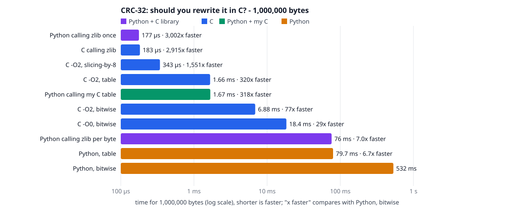

# C vs Python: should you rewrite it in C?

COMP 211 Checkoff 3 · Topic: Performance Benchmarking, C vs. Python.

## About this project

Have you ever been to the Fort Worth zoo and gotten lost, found a sign with a QR code that pulls up a map, scanned it, and then it tries to pull up a website, but your cell reception is terrible and the site never loads? Well, I have. I thought to myself ‘why can’t it just transfer the actual file data instead of pointing to a link?’ I then learned about the world of local file transfer via QR codes. Today, I'll be benchmarking Python and C in order to determine which is more efficient in processing a crucial aspect of QR transfer- validation. In this repo, I compare Python and C head-to-head in CRC32 validation.

## What I found

C, at its core is certainly more efficient. However, by leveraging this efficiency through calling C libraries via python, their results were nearly identical, with Python actually executing faster than bare C with both programs calling zlib.

## Slides

[`slides/slides.pdf`](slides/slides.pdf).

## Results (1 MB of random bytes, on my Ubuntu server)

AMD Ryzen 7 5800X, Ubuntu 24.04, gcc 13.3, Python 3.12, zlib 1.3. Each time is the median of 15 timed runs
in 3 fresh processes. Every version computed the same checksum. Full tables: [`results/crc32/summary.md`](results/crc32/summary.md).

| version | time for 1 MB | times faster than Python, bitwise |
|---|---|---|
| Python, bitwise | 532 ms | 1x |
| Python, lookup table | 79.7 ms | 6.7x |
| Python calling `zlib.crc32` once per byte | 76.0 ms | 7.0x |
| C `-O0`, bitwise | 18.4 ms | 29x |
| C `-O2`, bitwise | 6.88 ms | 77x |
| Python calling my C table loop through `ctypes` | 1.67 ms | 318x |
| C `-O2`, lookup table | 1.66 ms | 320x |
| C `-O2`, slicing-by-8 | 343 µs | 1,551x |
| C calling zlib | 183 µs | 2,915x |
| Python calling `zlib.crc32` once | 177 µs | 3,002x |



## What's in this repo

| folder | what it holds |
|---|---|
| `experiments/crc32/` | the same CRC-32 checksum written 10 ways in Python and C (see its README) |
| `results/crc32/` | full results: tables, charts and every single timing |
| `kit/` | the benchmark kit (`bench.py`) and the live demos (`demo.py`) |
| `slides/` | the presentation slides, and images of the code, demos and charts used in them |

## How to run it

You need a C compiler, zlib and Python 3.9 or newer. On Ubuntu: `sudo apt install build-essential zlib1g-dev python3`.
On a Mac: `xcode-select --install`. No Python packages are needed. Run everything from the repo root:

```bash
python3 kit/bench.py crc32 --quick   # a few seconds: smoke test (writes to results-quick/)
python3 kit/bench.py crc32           # the full run, about 4 minutes (writes to results/)

python3 kit/demo.py steps    # what one CRC step does to one byte, bit by bit
python3 kit/demo.py flip     # flip one bit of a message: the checksum changes completely
python3 kit/demo.py ladder   # the same checksum of 1 MB, from pure Python up to zlib
python3 kit/demo.py calls    # 1 call vs 1 million calls into C: the price of crossing over
```

Your numbers will differ on another machine. The order of the versions should stay the same.

## How the kit measures (and why)

| choice | why |
|---|---|
| each program times itself with a monotonic clock (`clock_gettime` in C, `time.perf_counter_ns` in Python) | measures only the checksum, not starting Python or loading the file |
| one untimed warm-up run per process | the first run pays for cold caches and memory being mapped in |
| 3 fresh processes x 5 timed runs each | catches variation between runs and between launches |
| versions take turns (A, B, C, A, B, C...) | slow drift on the machine hits every version equally |
| report the median, the 25th-75th percentile spread and the noise % | one unlucky slow run can't skew the result |
| every version prints its checksum and the kit compares them | proves each version did the same work, and stops the C compiler from deleting it |
| same input bytes for every version (a fixed random seed) | no version gets easier data |
| machine load recorded before and after | a busy machine makes everything slower and noisier |

## References

Sources the code is based on:

- zlib's CRC-32 source, which works on several 8-byte words at a time ("braids"): [madler/zlib, `crc32.c`](https://github.com/madler/zlib/blob/develop/crc32.c)
- Python docs: [`zlib.crc32`](https://docs.python.org/3/library/zlib.html#zlib.crc32) and [`ctypes`](https://docs.python.org/3/library/ctypes.html)
- Ross N. Williams, *A Painless Guide to CRC Error Detection Algorithms* (1993): the bitwise and table methods. [A copy](https://pic.hallikainen.org/techref/method/math/crcguide.html)
- M. E. Kounavis and F. L. Berry, "A Systematic Approach to Building High Performance Software-based CRC Generators", IEEE ISCC 2005, [doi:10.1109/ISCC.2005.18](https://doi.org/10.1109/ISCC.2005.18): slicing-by-8
- Wikipedia, [Computation of cyclic redundancy checks](https://en.wikipedia.org/wiki/Computation_of_cyclic_redundancy_checks)

## AI use

**EDIT:** Link your written reflection and your AI conversation, and say in one sentence that Claude Code (an AI coding tool) built the benchmark kit and ran the experiments while the slides and talk are yours.
