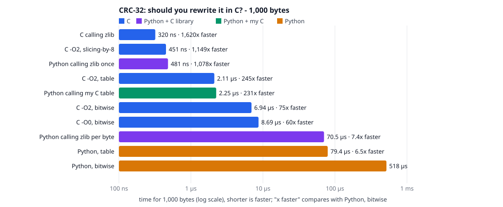
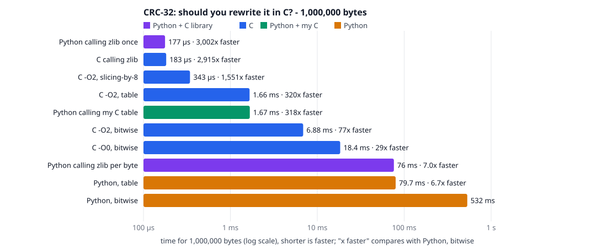
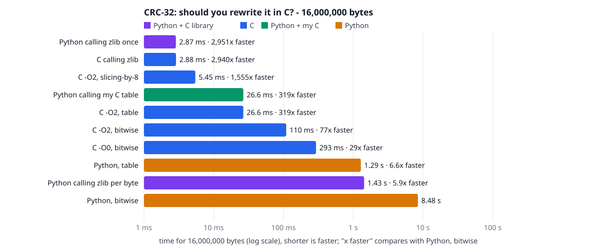

# CRC-32: should you rewrite it in C?

Generated by `kit/bench.py` on 2026-11-17T15:32:14. 3 fresh processes x 5 timed runs per case, after 1 warm-up run each.

- CPU: AMD Ryzen 7 5800X 8-Core Processor (16 logical CPUs), governor: performance
- OS: Linux 6.17.2-1-pve; compiler: gcc (Ubuntu 13.3.0-6ubuntu2~24.04.1) 13.3.0; Python 3.12.3; zlib 1.3
- Machine load (1-minute average) before / after: 0.29 / 1.32
- **median** = middle timed run. **spread** = 25th to 75th percentile. **noise** = coefficient of variation (standard deviation / mean). **vs ref** = how many times faster than `py_bitwise`.

## n = 1,000 bytes

| case | median | per item | spread | noise | first (warm-up) run | vs ref | peak memory | answer |
|---|---|---|---|---|---|---|---|---|
| `c_zlib` | 320 ns | 0.32 ns | 310 ns - 330 ns | 10.0% | 2.17 µs | 1.62e+03x | 1 MB | same |
| `c_slice8_O2` | 451 ns | 0.451 ns | 451 ns - 461 ns | 3.7% | 621 ns | 1.15e+03x | 1 MB | same |
| `py_zlib` | 481 ns | 0.481 ns | 360 ns - 782 ns | 46.5% | 1.91 µs | 1.08e+03x | 8 MB | same |
| `c_table_O2` | 2.11 µs | 2.11 ns | 2.1 µs - 2.11 µs | 0.7% | 2.23 µs | 245x | 1 MB | same |
| `py_ctypes` | 2.25 µs | 2.25 ns | 2.19 µs - 2.42 µs | 18.3% | 7.46 µs | 231x | 9 MB | same |
| `c_bitwise_O2` | 6.94 µs | 6.94 ns | 6.9 µs - 6.97 µs | 0.5% | 7.02 µs | 74.7x | 1 MB | same |
| `c_bitwise_O0` | 8.69 µs | 8.69 ns | 8.66 µs - 23 µs | 55.0% | 23.2 µs | 59.7x | 1 MB | same |
| `py_zlib_per_byte` | 70.5 µs | 70 ns | 70 µs - 70.9 µs | 3.4% | 76.4 µs | 7.35x | 8 MB | same |
| `py_table` | 79.4 µs | 79 ns | 78.2 µs - 79.6 µs | 1.4% | 81.9 µs | 6.53x | 8 MB | same |
| `py_bitwise` | 518 µs | 518 ns | 511 µs - 595 µs | 14.2% | 554 µs | 1x | 8 MB | same |

## n = 1,000,000 bytes

| case | median | per item | spread | noise | first (warm-up) run | vs ref | peak memory | answer |
|---|---|---|---|---|---|---|---|---|
| `py_zlib` | 177 µs | 0.177 ns | 177 µs - 182 µs | 1.8% | 184 µs | 3e+03x | 9 MB | same |
| `c_zlib` | 183 µs | 0.183 ns | 182 µs - 224 µs | 10.5% | 192 µs | 2.91e+03x | 2 MB | same |
| `c_slice8_O2` | 343 µs | 0.343 ns | 339 µs - 346 µs | 1.7% | 346 µs | 1.55e+03x | 2 MB | same |
| `c_table_O2` | 1.66 ms | 1.66 ns | 1.66 ms - 1.7 ms | 2.5% | 1.67 ms | 320x | 2 MB | same |
| `py_ctypes` | 1.67 ms | 1.67 ns | 1.66 ms - 1.71 ms | 3.9% | 1.67 ms | 318x | 10 MB | same |
| `c_bitwise_O2` | 6.88 ms | 6.88 ns | 6.85 ms - 7.01 ms | 1.5% | 6.9 ms | 77.4x | 2 MB | same |
| `c_bitwise_O0` | 18.4 ms | 18 ns | 18.2 ms - 18.7 ms | 2.6% | 18.7 ms | 29x | 2 MB | same |
| `py_zlib_per_byte` | 76 ms | 76 ns | 75.6 ms - 77 ms | 1.2% | 76.4 ms | 7x | 9 MB | same |
| `py_table` | 79.7 ms | 80 ns | 79.5 ms - 81.1 ms | 1.4% | 80.5 ms | 6.67x | 9 MB | same |
| `py_bitwise` | 532 ms | 532 ns | 529 ms - 657 ms | 19.0% | 533 ms | 1x | 9 MB | same |

## n = 16,000,000 bytes

| case | median | per item | spread | noise | first (warm-up) run | vs ref | peak memory | answer |
|---|---|---|---|---|---|---|---|---|
| `py_zlib` | 2.87 ms | 0.18 ns | 2.87 ms - 2.88 ms | 1.0% | 2.85 ms | 2.95e+03x | 23 MB | same |
| `c_zlib` | 2.88 ms | 0.18 ns | 2.87 ms - 2.91 ms | 1.7% | 2.91 ms | 2.94e+03x | 17 MB | same |
| `c_slice8_O2` | 5.45 ms | 0.341 ns | 5.45 ms - 5.47 ms | 0.3% | 5.45 ms | 1.55e+03x | 16 MB | same |
| `py_ctypes` | 26.6 ms | 1.66 ns | 26.6 ms - 26.6 ms | 0.3% | 26.6 ms | 319x | 24 MB | same |
| `c_table_O2` | 26.6 ms | 1.66 ns | 26.6 ms - 26.6 ms | 0.6% | 26.6 ms | 319x | 16 MB | same |
| `c_bitwise_O2` | 110 ms | 6.85 ns | 109 ms - 110 ms | 0.5% | 110 ms | 77.4x | 17 MB | same |
| `c_bitwise_O0` | 293 ms | 18 ns | 292 ms - 294 ms | 0.3% | 295 ms | 28.9x | 16 MB | same |
| `py_table` | 1.29 s | 80 ns | 1.28 s - 1.29 s | 1.7% | 1.29 s | 6.59x | 24 MB | same |
| `py_zlib_per_byte` | 1.43 s | 90 ns | 1.22 s - 1.79 s | 16.7% | 1.44 s | 5.92x | 24 MB | same |
| `py_bitwise` | 8.48 s | 530 ns | 8.35 s - 8.51 s | 2.5% | 8.56 s | 1x | 24 MB | same |

## What each case is

| case | how it was built | description |
|---|---|---|
| `py_bitwise` | python3 | Python, 8 shift/XOR steps per byte |
| `py_table` | python3 | Python, 256-entry lookup table |
| `c_bitwise_O0` | `gcc -O0` | C, 8 shift/XOR steps per byte, no optimisation |
| `c_bitwise_O2` | `gcc -O2` | C, 8 shift/XOR steps per byte, -O2 |
| `c_table_O2` | `gcc -O2` | C, lookup table, -O2 |
| `c_slice8_O2` | `gcc -O2` | C, slicing-by-8: 8 tables, 8 bytes per step, -O2 |
| `py_ctypes` | python3 | Python calling the C table loop (crc_hotspot.c, -O2) through ctypes |
| `py_zlib` | python3 | zlib.crc32(data) from Python, one call |
| `py_zlib_per_byte` | python3 | zlib.crc32 from Python, called once per byte |
| `c_zlib` | `gcc -O2 -DHAVE_ZLIB` | C calling zlib's crc32() |
